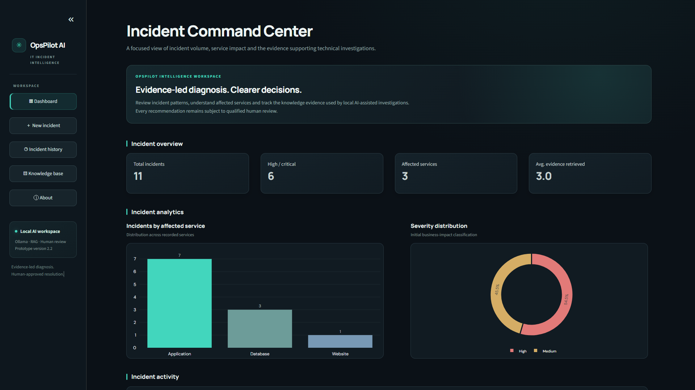
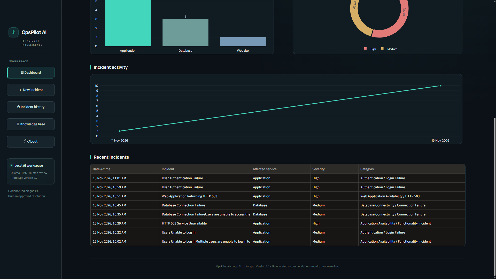
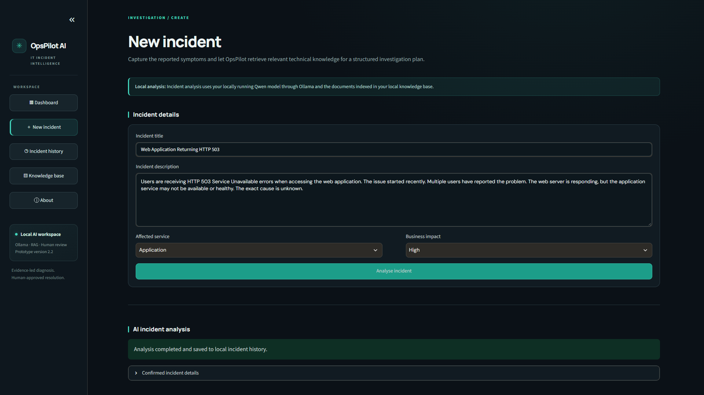
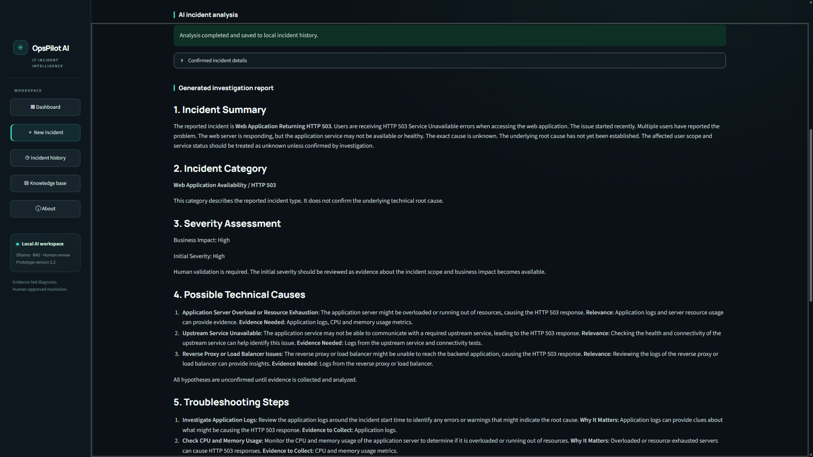
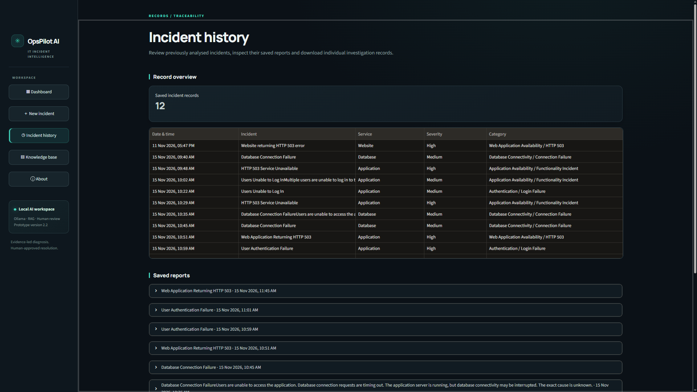
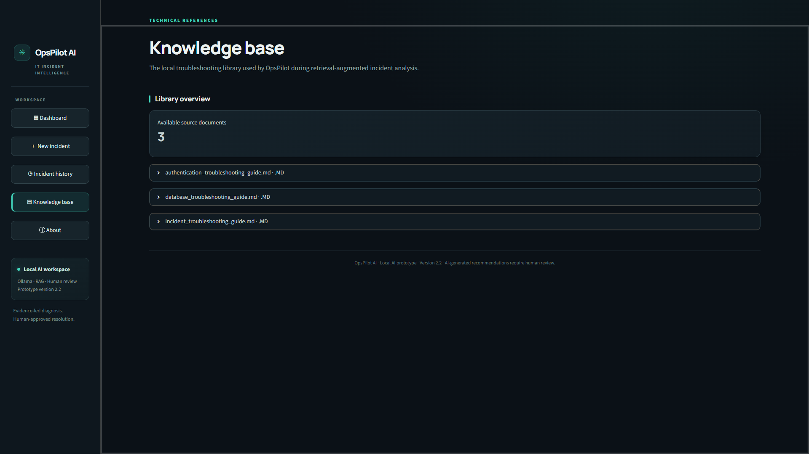
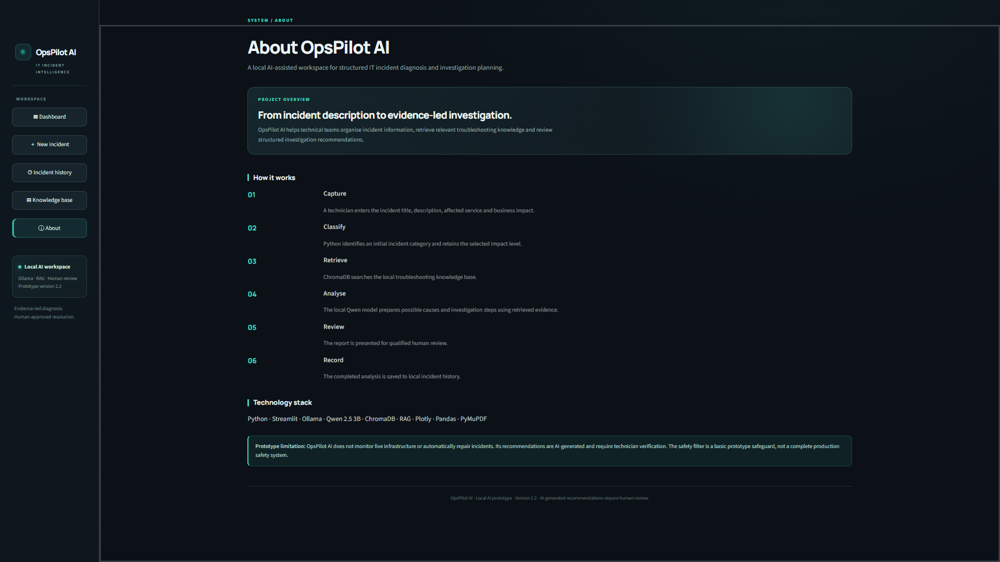

# OpsPilot AI
### AI-Powered IT Incident Diagnosis and Resolution Assistant

OpsPilot AI is a local AI-assisted application designed to help IT teams organise incident information, retrieve relevant troubleshooting knowledge, explore possible technical causes, and plan structured investigation steps.

It combines a locally running Large Language Model (LLM) with Retrieval-Augmented Generation (RAG) to generate evidence-aware incident analysis and support human-led troubleshooting.

## Problem Statement

IT teams often receive incident reports containing incomplete or unstructured information. Understanding possible causes and identifying the next investigation steps can take time.

OpsPilot AI aims to assist technicians by organising incident details, retrieving relevant technical knowledge, and generating structured investigation recommendations.

## Key Features

- Incident submission through a Streamlit interface.
- Initial incident classification based on incident details and affected service.
- AI-generated incident summaries and possible technical causes.
- Local knowledge retrieval using Retrieval-Augmented Generation (RAG).
- Evidence references from troubleshooting documents.
- Structured investigation and troubleshooting recommendations.
- Initial severity based on reported business impact.
- Dashboard with incident statistics and visualisations.
- Incident history with saved analysis records.
- Downloadable Markdown incident reports.
- Local AI inference without a paid external LLM API.
- Human review emphasis before production-changing actions.

## Technology Stack

| Technology | Purpose |
|---|---|
| Python | Application development |
| Streamlit | User interface |
| Ollama | Local LLM execution |
| Qwen 2.5 3B | Incident analysis |
| ChromaDB | Vector database |
| nomic-embed-text | Text embeddings |
| PyMuPDF | PDF text extraction |
| Pandas | Data handling |
| Plotly | Dashboard visualisations |
| Git and GitHub | Version control |

## How It Works

1. **Capture:** A technician enters the incident title, description, affected service, and business impact.
2. **Classify:** Python identifies an initial incident category.
3. **Retrieve:** ChromaDB retrieves relevant troubleshooting information from the local knowledge base.
4. **Analyse:** The local Qwen model generates possible causes and investigation recommendations using the incident details and retrieved context.
5. **Review:** The generated report is presented for qualified human review.
6. **Record:** The analysis is saved in local incident history for later reference.

## Architecture

```text
User
  |
  v
Streamlit Interface
  |
  v
Incident Classification
  |
  v
Knowledge Retrieval
  |
  +------> ChromaDB
  |           |
  |           v
  |     Technical Documents
  |
  v
Retrieved Context + Incident Details
  |
  v
Ollama - Qwen 2.5 3B
  |
  v
AI Incident Analysis
  |
  v
Structured Incident Report
  |
  +------> Local Incident Storage
  |
  v
Human Review
```

## Project Structure

```text
OpsPilot-AI/
|
├── app.py
├── knowledge_base.py
├── incident_storage.py
├── requirements.txt
├── README.md
├── .gitignore
|
└── data/
    ├── authentication_troubleshooting_guide.md
    ├── database_troubleshooting_guide.md
    └── incident_troubleshooting_guide.md
```

The ChromaDB database and incident records are stored locally by the application and are not intended to be shared as generated runtime data.

## Installation and Setup

### 1. Clone the Repository

```bash
git clone https://github.com/archasunil1111-jpg/OpsPilot-AI.git
cd OpsPilot-AI
```

### 2. Create a Virtual Environment

```bash
python -m venv venv
```

Activate it on Windows:

```bash
venv\Scripts\activate
```

### 3. Install Dependencies

```bash
pip install -r requirements.txt
```

### 4. Install Ollama Models

Install Ollama from:

https://ollama.com/

Pull the required models:

```bash
ollama pull qwen2.5:3b
ollama pull nomic-embed-text
```

Ensure Ollama is running before starting the application.

### 5. Prepare the Knowledge Base

```bash
python knowledge_base.py
```

This processes supported technical documents from the local `data/` directory and prepares the knowledge base for retrieval.

### 6. Run the Application

```bash
streamlit run app.py
```

The application will open in your browser.

## Current Knowledge Base

The prototype includes three troubleshooting documents:

1. **HTTP 503 Service Unavailable:** Application availability and upstream service troubleshooting.
2. **Database Troubleshooting:** Database connectivity and connection failure investigation.
3. **Authentication Troubleshooting:** Login failures, authentication services, SSO, MFA, and token validation.

## Application Pages

- **Dashboard:** Displays incident statistics, severity distribution, affected services, and recent incident activity.
- **New Incident:** Accepts incident information and generates a structured investigation report.
- **Incident History:** Displays previously saved incident analyses.
- **Knowledge Base:** Provides access to the local troubleshooting documents.
- **About:** Explains the project workflow, technologies, and limitations.

## Project Screenshots

### 1. Dashboard




### 2. New Incident




### 3. Incident History


### 4. Knowledge Base


### 5. About


## Testing

The prototype has been tested using three sample incident scenarios:

### 1. Database Connection Failure
- Database connectivity incident classification.
- Retrieval of database troubleshooting information.
- Generation of possible causes and investigation steps.

### 2. HTTP 503 Service Unavailable
- Application availability incident classification.
- Retrieval of HTTP 503 troubleshooting information.
- Generation of possible causes and investigation recommendations.

### 3. User Authentication Failure
- Authentication and login incident classification.
- Retrieval of authentication troubleshooting information.
- Generation of relevant investigation recommendations.

These tests demonstrate the prototype's incident analysis, knowledge retrieval, report generation, and incident history workflow.

## Limitations

- This is a local AI prototype, not a production IT monitoring platform.
- It does not monitor live company infrastructure or real-time server health.
- Its analysis depends on the information supplied by users and the available knowledge documents.
- AI-generated causes are hypotheses, not confirmed root-cause diagnoses.
- It does not automatically execute repairs or modify production systems.
- AI-generated recommendations require qualified technician verification.
- The safety filter is a basic prototype safeguard, not a complete production safety system.
- Model response speed depends on available hardware resources.

## Future Improvements

- Support for additional incident categories and technical knowledge sources.
- Improved retrieval relevance and source-level filtering.
- More comprehensive validation and safety controls.
- Automated evaluation of diagnosis quality.
- Integration with authorised IT service management platforms.

## Responsible AI and Human Oversight

OpsPilot AI is designed as an incident investigation decision-support assistant.

Its output should not be treated as a confirmed root-cause diagnosis. Technicians must validate evidence, review recommendations, and approve production-changing actions.

---

**Project:** OpsPilot AI  
**Version:** 2.2  
**Type:** Individual AI Project  
**Execution:** Local AI Workspace
